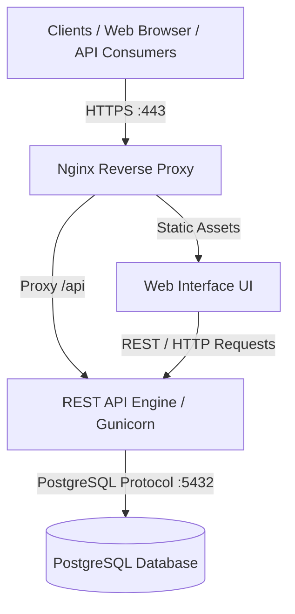

# Service Desk Platform

A distributed Service Desk management system designed, deployed, and operated as part of the Service Engineering curriculum.

## 📌 Project Overview
The Service Desk Platform allows users to view, create, update, and manage system incidents. It is built using a multi-tier distributed architecture ensuring high availability, security, and end-to-end observability.

---

## 🏗 System Architecture (for Part 1)

---

## 🛠 Tech Stack

- **Operating System:** Linux (Ubuntu)
- **Web Server & Reverse Proxy:** Nginx
- **Application Framework:** Python (Flask + Gunicorn)
- **Database:** PostgreSQL
- **Service Management:** `systemd`
- **Observability Stack (Part 2):** Prometheus, Grafana, Node Exporter, Alertmanager

---

## 🚀 Deployment Progress

### Part 1: Design and Deployment
- [x] **Phase 1: VM Preparation & Network Hardening**
  - Updated system dependencies and configured hostname (`servicedesk-vm`).
  - Implemented non-privileged system user (`servicedesk`).
  - Configured firewall (`ufw`) allowing strictly SSH (22), HTTP (80), and HTTPS (443).
- [x] **Phase 2: Database Service & Schema Implementation**
  - Installed and secured PostgreSQL service.
  - Created dedicated application database (servicedesk) and unprivileged DB user.
  - Implemented schema for users, incidents, and comments with strict NOT NULL constraints and timestamp triggers.
- [ ] **Phase 3: REST API Implementation**
- [ ] **Phase 4: API Documentation (OpenAPI / Swagger)**
- [ ] **Phase 5: Web User Interface**
- [ ] **Phase 6: Nginx Reverse Proxy Integration**
- [ ] **Phase 7: HTTPS / TLS Certificate Configuration**
- [ ] **Phase 8: systemd Automation & Service Management**
- [ ] **Phase 9: Logging & Diagnostics**
- [ ] **Phase 10: System Security Hardening**
- [ ] **Phase 11: System Verification & Testing**

### Part 2: Operation & Observability
- [ ] **Phase 1: Definition of Indicators**
- [ ] **Phase 2: System Monitoring (Node Exporter)**
- [ ] **Phase 3: Application Metrics (/metrics)**
- [ ] **Phase 4: Health Check (/health)**
- [ ] **Phase 5: Grafana Dashboard Setup**
- [ ] **Phase 6: Threshold Definition**
- [ ] **Phase 7: Alerting System (Prometheus Rules)**
- [ ] **Phase 8: Notification Delivery (Alertmanager)**
- [ ] **Phase 9: Load Generation & Testing**
- [ ] **Phase 10: Performance Analysis & Saturation Point**
- [ ] **Phase 11: Automated Database Backups**
- [ ] **Phase 12: Business Continuity & Controlled Disaster Recovery**
- [ ] **Phase 13: RPO & RTO Measurement**
- [ ] **Phase 14: Incident Simulation & Diagnostic Drills**
- [ ] **Phase 15: Infrastructure Reboot & Service Auto-Start**
- [ ] **Phase 16: Operations Runbook & Operational Report**
---

## 📖 Technical Report & Documentation

Detailed execution evidence, architectural decisions, and step-by-step logs are documented in the [Technical Report](docs/technical-report.md).