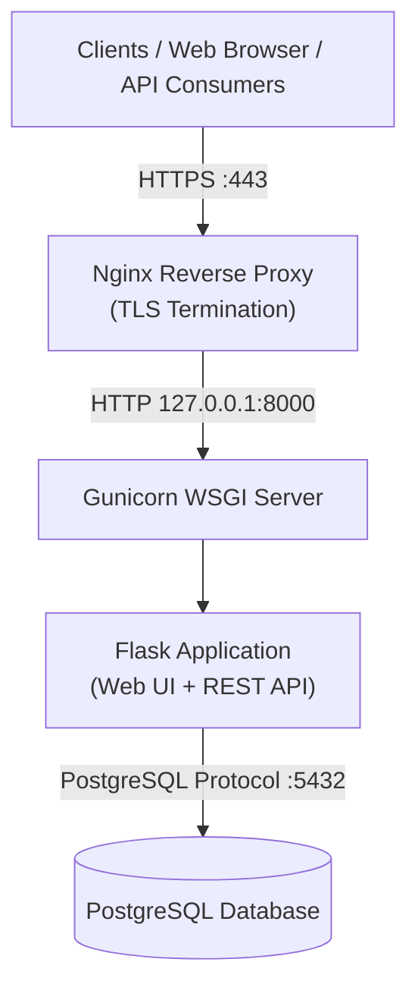

# Service Desk Platform

A distributed Service Desk management system designed, deployed, and operated as part of the Service Engineering curriculum.

## 📌 Project Overview
The Service Desk Platform allows users to view, create, update, and manage system incidents. It is built using a multi-tier distributed architecture ensuring high availability, security, and end-to-end observability.

---

## 🏗 System Architecture (for Part 1)

---

## 🛠 Tech Stack

- **Operating System:** Linux (Ubuntu)
- **Web Server & Reverse Proxy:** Nginx
- **Application Framework:** Python (Flask + Gunicorn)
- **Database:** PostgreSQL
- **Service Management:** `systemd`
- **Observability Stack (Part 2):** Prometheus, Grafana, Node Exporter, Alertmanager

---

## 🚀 Deployment Progress

### Part 1: Design and Deployment
- [x] **Phase 1: VM Preparation & Network Hardening**
  - Updated system dependencies and configured hostname (`servicedesk-vm`).
  - Implemented non-privileged system user (`servicedesk`).
  - Configured firewall (`ufw`) allowing strictly SSH (22), HTTP (80), and HTTPS (443).
- [x] **Phase 2: Database Service & Schema Implementation**
  - Installed and secured PostgreSQL service.
  - Created dedicated application database (servicedesk) and unprivileged DB user.
  - Implemented schema for users, incidents, and comments with strict NOT NULL constraints and timestamp triggers.
- [x] **Phase 3: REST API Implementation**
  - Built modular Flask backend with SQLAlchemy ORM.
  - Implemented CRUD REST API endpoints for /api/users, /api/incidents, and /api/incidents/<id>/comments.
  - Enforced unprivileged PostgreSQL service connection.
- [x] **Phase 4: API Documentation (OpenAPI / Swagger)**
  - Integrated Flasgger library for automated Swagger UI generation.
  - Documented OpenAPI specs for all `/api/users`, `/api/incidents`, and `/api/comments` endpoints at `/apidocs`.
- [x] **Phase 5: Web User Interface**
  - Built a modular web frontend using Flask Blueprints (`src/web/`) and Jinja2 templates.
  - Created dashboard (`index.html`) for incident listing and creation, plus detail views (`detail.html`) for status updates and comment threads.
  - Connected frontend forms to the REST API via asynchronous JavaScript (`fetch` API) and styled with custom CSS.
- [x] **Phase 6: Production Deployment (Gunicorn & Nginx Reverse Proxy)**
  - Configured multi-worker WSGI execution using **Gunicorn** managed by a custom `systemd` service (`servicedesk.service`).
  - Deployed **Nginx** as a reverse proxy on port `80`, forwarding requests to the internal Gunicorn socket (`127.0.0.1:8000`) and serving static files.
- [x] **Phase 7: HTTPS / TLS Certificate Configuration**
  - Generated a 2048-bit RSA self-signed SSL/TLS certificate using OpenSSL.
  - Configured **Nginx** to terminate TLSv1.2/TLSv1.3 traffic on port `443` and enforce permanent HTTP-to-HTTPS redirection (`301`) from port `80`.
- [x] **Phase 8: Systemd Service Management & Lifecycle Control**
  - Standardized the application unit as `servicedesk-api.service` to clearly distinguish the backend WSGI/API service from the Nginx reverse proxy and PostgreSQL database units.
  - Enforced strict service dependencies (`Requires=postgresql.service`, `After=network.target postgresql.service`), production environment variables (`FLASK_ENV=production`), unprivileged execution (`User=uo324701`), and automatic fault recovery (`Restart=on-failure`, `RestartSec=5`).
- [x] **Phase 9: Logging & Diagnostics**
  - Configured dedicated Nginx access and error logs (`/var/log/nginx/servicedesk_access.log`, `/var/log/nginx/servicedesk_error.log`) and enabled structured Gunicorn request/error logging (`--access-logfile -`, `--error-logfile -`) routed to `systemd-journald`.
  - Verified cross-layer log correlation across Nginx, Gunicorn/Flask, `journalctl`, and PostgreSQL (`/var/log/postgresql/`).
- [x] **Phase 10: Security Hardening & Access Control**
  - Enforced network perimeter protection via `UFW` (exposing only ports `22`, `80`, and `443`) while isolating Gunicorn (`127.0.0.1:8000`) and PostgreSQL (`127.0.0.1:5432`) strictly to loopback interfaces.
  - Applied principle of least privilege across OS and database layers (`uo324701` service user, dedicated `servicedesk_user` DB role, `chmod 600` on sensitive files), externalized database credentials and `SECRET_KEY` out of source code into `/etc/servicedesk.env` (`chmod 640`, loaded via `systemd` `EnvironmentFile`), disabled Nginx version disclosure (`server_tokens off`), and verified hardened SSH settings.
- [x] **Phase 11: System Verification & Testing**
  - Created an automated verification suite (`scripts/run_tests.sh`) alongside manual validation covering REST API CRUD and comment workflows, full-stack integration (`Web UI -> REST API -> PostgreSQL`), external port isolation (`5432`, `8000`), and automatic service recovery after a full VM reboot.

### Part 2: Operation & Observability
- [x] **Phase 1: Definition of Indicators**
  - Defined and justified Service Level Indicators (SLIs) across infrastructure (CPU, RAM, disk, load average, network), application service (throughput, HTTP error rate, p50/p95/p99 latency, availability), and database layers (`SELECT 1` availability and latency).
- [x] **Phase 2: System Monitoring (Node Exporter & Prometheus)**
  - Deployed `node_exporter` (`127.0.0.1:9100`) and `prometheus` (`127.0.0.1:9090`) as isolated `systemd` services running under dedicated unprivileged system users (`node_exporter`, `prometheus`) with 15-day / 1 GB TSDB retention limits.
- [x] **Phase 3: Application Metrics (/metrics)**
  - Instrumented the Flask/Gunicorn backend (`src/metrics.py`) with `prometheus-client` (`v0.21.1`) using `PROMETHEUS_MULTIPROC_DIR` (`/dev/shm/servicedesk_prom`) to aggregate `servicedesk_http_requests_total` and `servicedesk_http_request_duration_seconds` across all 3 Gunicorn workers, and added `127.0.0.1:8000/metrics` as an active Prometheus scrape target.
- [x] **Phase 4: Health Check (/health)**
  - Implemented `GET /health` (`src/health.py`) executing an active `SELECT 1` probe against PostgreSQL, returning `200 OK` with query latency in milliseconds (`503 Service Unavailable` on DB failure) and exporting `servicedesk_db_up` and `servicedesk_db_health_check_duration_seconds` to `/metrics`.
- [x] **Phase 5: Grafana Dashboard Setup**
  - Deployed `grafana-server` restricted to `127.0.0.1:3000` (accessed via SSH tunnel), provisioned the Prometheus datasource and the 9-panel `Service Desk Platform - Operations Overview` dashboard (`config/grafana/`) covering system, application, and PostgreSQL health metrics.
- [x] **Phase 6: Alert Threshold Definition**
  - Defined and justified `Warning` and `Critical` alerting thresholds in `docs/operations-report.md` calibrated to the VM's 2 vCPU / 1.6 GiB RAM profile, covering service availability, PostgreSQL probe health, `5xx`/`4xx` error rates, `p95` latency, CPU, RAM, and disk saturation.
- [x] **Phase 7: Prometheus Alert Rules & Alertmanager**
  - Deployed `alertmanager` (`v0.27.0`) as a `systemd` service bound to `127.0.0.1:9093`, implemented 13 `Warning`/`Critical` alerting rules (`config/prometheus/alert_rules.yml`), configured severity-based routing (`config/alertmanager/alertmanager.yml`), and verified rule evaluation in Prometheus.
- [x] **Phase 8: Slack Webhook Integration & End-to-End Alerting Verification**
  - Integrated Alertmanager with Slack Incoming Webhooks (`#servicedesk-alerts`) via `systemd` `RuntimeDirectory` + `envsubst` secret injection, decoupled `servicedesk-api` from `postgresql` (`Wants=`), and verified the full `FIRING -> RESOLVED` alerting lifecycle via controlled PostgreSQL fault injection.
- [x] **Phase 9: Load Generation & Testing**
  - Implemented `scripts/load_test.sh` using ApacheBench (`ab`) across four progressive concurrency tiers (`c = 5, 20, 50, 100`; 11,500 total requests), archived raw results in `docs/evidence/load_test_results.txt`, and correlated traffic spikes with Grafana telemetry.
- [x] **Phase 10: Performance Analysis & Saturation Point**
  - Identified the system saturation threshold (`c ≈ 20`, ~600 req/s), quantified TCP queueing latency growth (`p50` scaling from 31 ms to 154 ms under saturation), and confirmed zero HTTP errors across all load tiers.
- [ ] **Phase 11: Automated Database Backups**
- [ ] **Phase 12: Business Continuity & Controlled Disaster Recovery**
- [ ] **Phase 13: RPO & RTO Measurement**
- [ ] **Phase 14: Incident Simulation & Diagnostic Drills**
- [ ] **Phase 15: Infrastructure Reboot & Service Auto-Start**
- [ ] **Phase 16: Operations Runbook & Operational Report**
---

## 📖 Technical Report & Documentation

- **Part 1 — Design & Deployment:** Detailed execution evidence, architectural decisions, and step-by-step logs are documented in the [Technical Report](docs/technical-report.md).
- **Part 2 — Operations & Observability:** Monitoring strategy, metrics, dashboards, alerting, load testing, and disaster recovery procedures are documented in the [Operations Report](docs/operations-report.md).