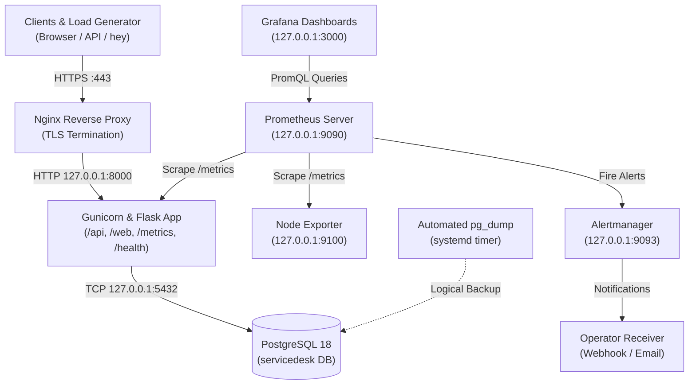
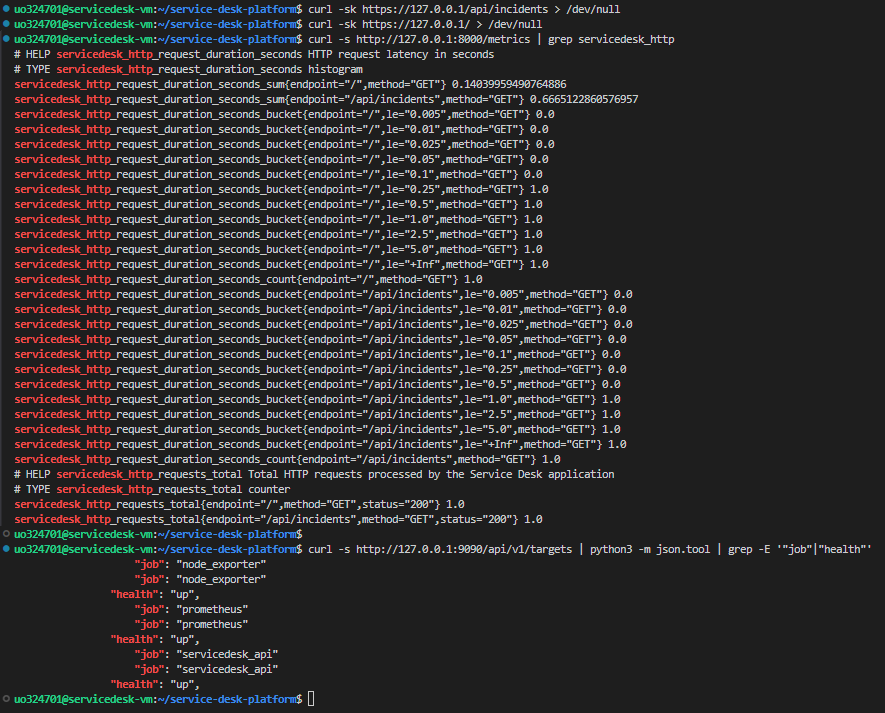
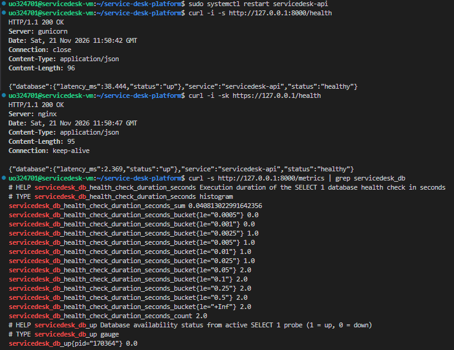
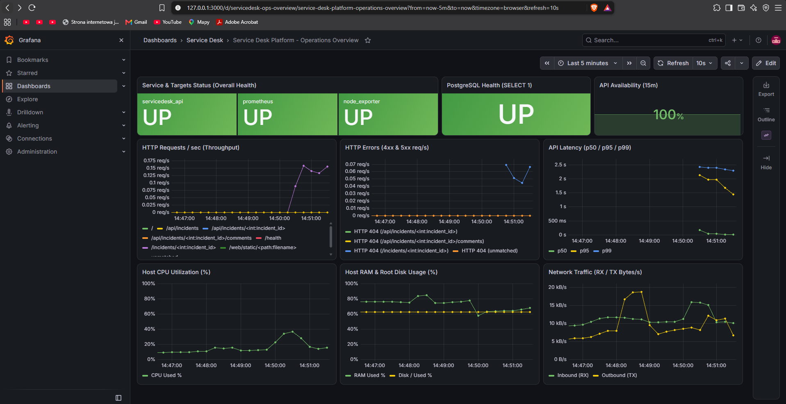
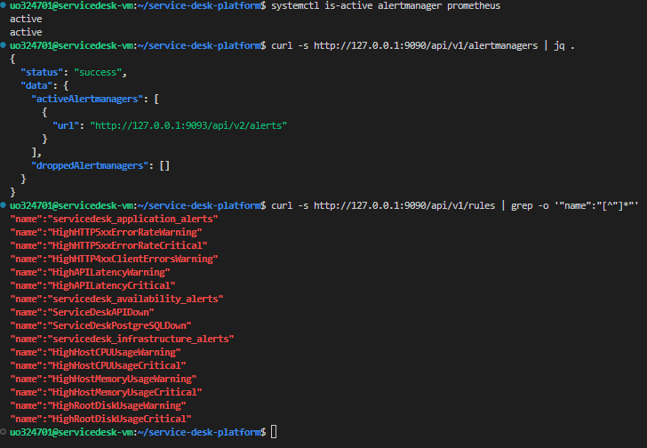
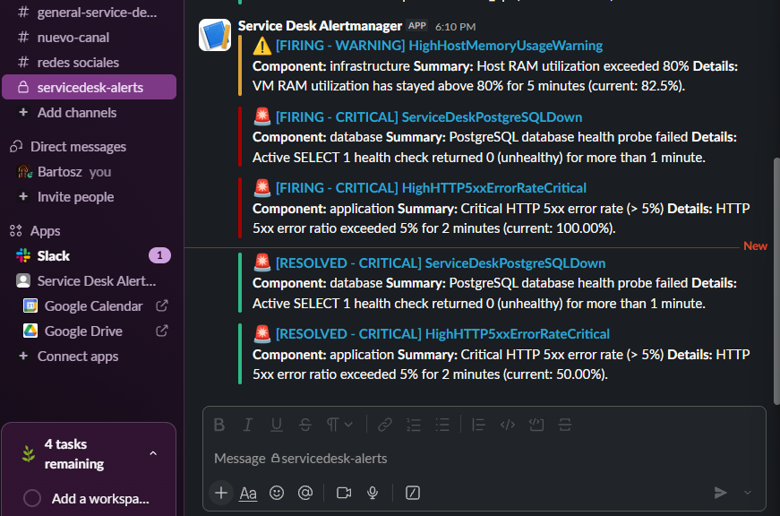
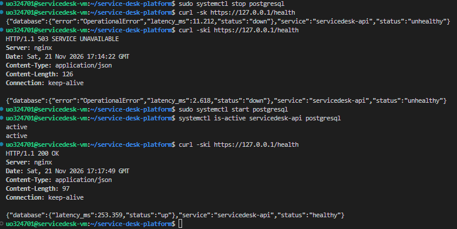
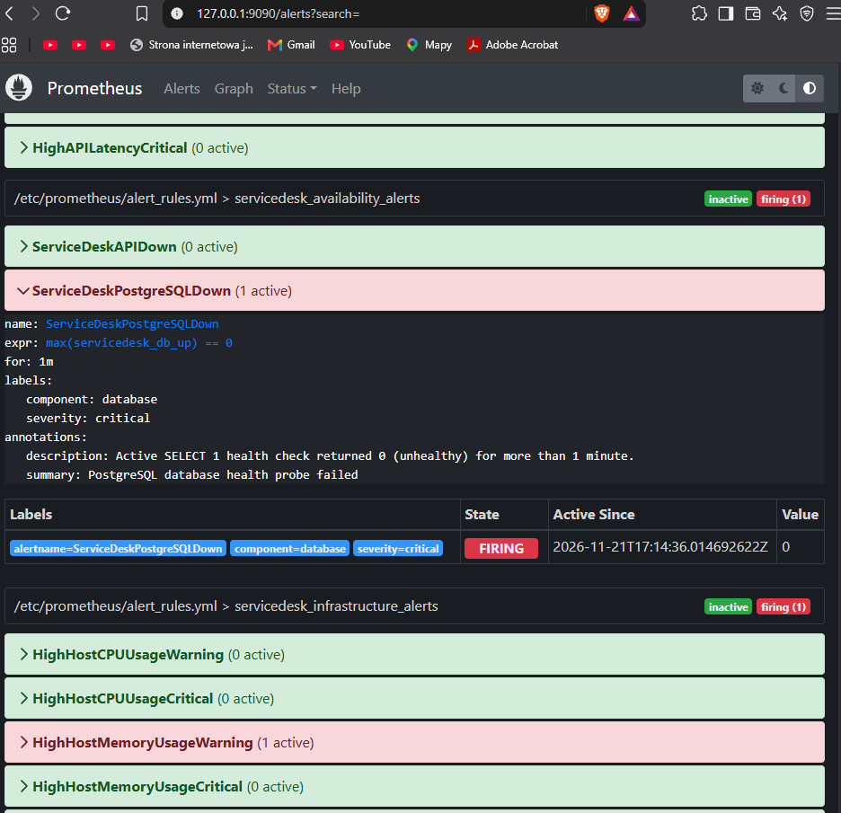
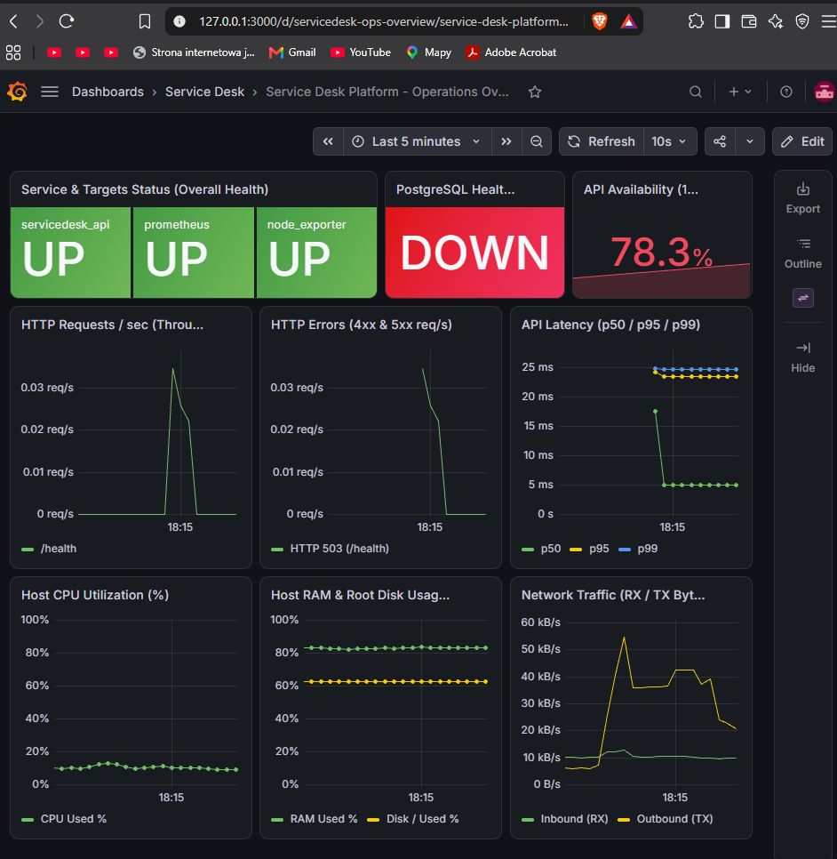

# Service Desk Platform - Part 2: Operations & Observability Report

## 1. Operational Context & Problem Statement
Following the production deployment of the **Service Desk Platform** in Part 1 (`Nginx + Gunicorn/Flask + PostgreSQL` on `servicedesk-vm`), ensuring functional availability alone is insufficient for reliable service operation. As the service operator, it is necessary to continuously observe system health, detect performance degradation before users are impacted, receive automated alerts during failures, evaluate capacity limits under load, and guarantee data continuity through automated backups and tested recovery procedures.

This report documents the implementation of the observability, alerting, performance testing, backup, and incident response architecture designed to answer critical operational questions:
- Is the service currently available and healthy across all layers (API, Web UI, Database)?
- Is response latency increasing or are HTTP error rates spiking?
- How much CPU, RAM, and disk capacity remain available on the virtual machine?
- When did the last failure occur, and which component triggered it?
- Can we recover the data if the database is lost, and how long does it take to restore the service within defined RPO and RTO targets?

---

## 2. Operational Architecture
To maintain low resource overhead on the virtual machine (`2 vCPU`, `1.6 GiB RAM`, `18 GB Storage`), the observability and backup components are deployed natively alongside the application stack as isolated `systemd` services bound strictly to the local loopback interface (`127.0.0.1`), with administrative dashboards accessed securely via Nginx HTTPS reverse proxy or local SSH port forwarding.

### 2.1 Operational Component & Telemetry Flow Diagram

---

## 3. Phase 1: Definition & Justification of Service Indicators

Before deploying monitoring agents, key Service Level Indicators (SLIs) were defined across three layers—infrastructure, application service, and database—to ensure complete end-to-end observability without unnecessary metric overhead.

### 3.1 Infrastructure Indicators (Host Layer)
Collected from the Linux virtual machine via **Node Exporter** (`/proc` and `/sys` kernel metrics):

| Indicator | Metric / Measurement | Operational Justification |
| :--- | :--- | :--- |
| **CPU Utilization** | Percentage of non-idle CPU time (`user`, `system`, `iowait`) | Identifies compute saturation caused by concurrent Gunicorn workers, TLS handshakes, or database queries on the 2-vCPU host. |
| **Memory Utilization** | Available vs. total physical RAM (`1.6 GiB`) and swap usage | Prevents Out-Of-Memory (OOM) terminations of PostgreSQL or Python processes under memory pressure. |
| **Disk Space Usage** | Used filesystem percentage on the root partition `/` (`18 GB`) | Ensures PostgreSQL data files, logs, and automated backups do not exhaust disk space and halt write operations. |
| **System Load Average** | 1-minute, 5-minute, and 15-minute runnable process queue (`node_load1/5/15`) | Complements CPU percentage by revealing process contention and disk I/O wait bottlenecks relative to the 2 CPU cores. |
| **Network Traffic** | Inbound/outbound bytes and packets per second (`RX/TX`) | Tracks client request volume, detects abnormal traffic spikes, and verifies network interface health. |

### 3.2 Application Service Indicators (API & Web Layer)
Exposed directly by the **Flask / Gunicorn** backend through a dedicated `/metrics` endpoint:

| Indicator | Metric / Measurement | Operational Justification |
| :--- | :--- | :--- |
| **Request Throughput** | Total HTTP requests partitioned by method, endpoint, and status code | Measures real-time traffic demand and distinguishes read operations (`GET`) from write operations (`POST`/`PUT`/`DELETE`). |
| **HTTP Error Rate** | Rate of `4xx` (client) and `5xx` (server) responses | Detects broken client requests (`4xx`) and internal application or database failures (`5xx`) immediately. |
| **Request Latency** | HTTP request duration histogram (`p50`, `p95`, `p99` response times) | Tracks median (`p50`) and worst-case (`p95`/`p99`) response times so service slowdowns are detected before reaching Nginx proxy timeout.|
| **Service Availability** | Prometheus `up` scrape target state (`1` = up, `0` = down) | Provides binary confirmation that the Gunicorn WSGI process is alive and responding to monitoring probes. |

### 3.3 Database Indicators (Persistence Layer)
Verified via active application probing (`/health` endpoint) and `systemd` service status:

| Indicator | Metric / Measurement | Operational Justification |
| :--- | :--- | :--- |
| **Database Availability** | Active `SELECT 1` connectivity check executed by `/health` | Confirms not only that the `postgresql` daemon is active, but that `servicedesk_user` can authenticate and execute SQL queries. |
| **DB Query Latency** | Round-trip execution time (in ms) of the `SELECT 1` probe | Complementary metric that exposes database connection latency increases. |

---

## 4. Phase 2: System Monitoring Deployment (Node Exporter & Prometheus)

To collect host-level infrastructure metrics without exposing administrative ports to external networks, **Node Exporter (`v1.8.2`)** and **Prometheus (`v2.55.1`)** were deployed as native `systemd` services bound strictly to the loopback interface (`127.0.0.1`).

### 4.1 Service Isolation & Resource Hardening
- **Least-Privilege Execution:** Dedicated unprivileged system accounts (`node_exporter` and `prometheus`) with `/usr/sbin/nologin` shells own the binaries, configuration directories (`/etc/prometheus`), and time-series storage (`/var/lib/prometheus`).
- **Network Isolation:** Both services listen exclusively on `127.0.0.1` (`:9100` and `:9090`), keeping them unreachable from external interfaces while remaining accessible to local scrape targets and SSH tunnels.
- **Storage Retention Caps:** Prometheus is configured with `--storage.tsdb.retention.time=15d` and `--storage.tsdb.retention.size=1GB` to prevent time-series data from exhausting the VM's `18 GB` root filesystem.
- **Reproducible Configuration:** Service unit files (`config/systemd/node_exporter.service`, `config/systemd/prometheus.service`) and scrape definitions (`config/prometheus/prometheus.yml`) are version-controlled in the repository.

### 4.2 Scrape Configuration (`config/prometheus/prometheus.yml`)
Prometheus polls metrics every `15s` from two initial targets:
- `prometheus` (`127.0.0.1:9090`): Self-monitoring of the Prometheus server health and TSDB ingestion.
- `node_exporter` (`127.0.0.1:9100`): Host CPU, memory, disk, load average, and network telemetry.

### 4.3 Verification Evidence
Service activation and target discovery were validated via `systemctl` and the Prometheus Targets HTTP API (`/api/v1/targets`):
- `systemctl is-active node_exporter prometheus` returned `active` for both units.
- `curl -s http://127.0.0.1:9100/metrics` confirmed live kernel metric exposition.
- Querying `http://127.0.0.1:9090/api/v1/targets` confirmed `"health": "up"` for both `node_exporter` and `prometheus` scrape jobs.

---

## 5. Phase 3: Application Service Instrumentation (`/metrics`)

To monitor application-level traffic, error rates, and latency directly from the backend, the Flask application was instrumented using the official **`prometheus-client` (`v0.21.1`)** library and exposed via a dedicated `/metrics` endpoint.

### 5.1 Multi-Worker Metric Aggregation (`Gunicorn`)
Because `servicedesk-api.service` runs **3 Gunicorn worker processes** (`--workers 3`), each worker maintains an independent memory space. To prevent fragmented or inconsistent metric scrapes across workers:
- `PROMETHEUS_MULTIPROC_DIR=/dev/shm/servicedesk_prom` is configured in `config/systemd/servicedesk-api.service` so all workers write shared memory-mapped metric files into `tmpfs` (`/dev/shm`).
- `ExecStartPre` cleans and recreates `/dev/shm/servicedesk_prom` on every service start or restart to prevent stale counter persistence across process lifecycles.
- The `/metrics` route uses `multiprocess.MultiProcessCollector` to aggregate counters and histogram buckets across all active workers into a single unified exposition response.

### 5.2 Exported Application Metrics (`src/metrics.py`)
Request hooks (`before_request` and `after_request`) capture telemetry for every incoming HTTP request while excluding `/metrics` scrapes themselves to avoid skewing traffic counts:
- **`servicedesk_http_requests_total` (Counter):** Counts total processed HTTP requests labeled by `method`, `endpoint` (normalized Flask URL rule, e.g., `/api/incidents`), and `status` (`200`, `4xx`, `5xx`), enabling throughput and error-rate calculations.
- **`servicedesk_http_request_duration_seconds` (Histogram):** Records request execution latency across 10 buckets (`5 ms` to `5.0 s`) labeled by `method` and `endpoint`, enabling `p50`, `p95`, and `p99` quantile queries via `histogram_quantile()`.

### 5.3 Verification Evidence
- Updated `config/prometheus/prometheus.yml` with the `servicedesk_api` scrape job targeting `127.0.0.1:8000/metrics`.
- Executed test requests against `https://127.0.0.1/` and `https://127.0.0.1/api/incidents` and confirmed accurate counter and histogram bucket increments at `http://127.0.0.1:8000/metrics`.
- Verified via `http://127.0.0.1:9090/api/v1/targets` that `prometheus`, `node_exporter`, and `servicedesk_api` all report `"health": "up"`.

---

## 6. Phase 4: Active Health Check Endpoint (`/health`)

To verify end-to-end service and database readiness beyond process liveness, an active `/health` endpoint was implemented in `src/health.py` and registered in the Flask application.

### 6.1 Probe Behavior & HTTP Semantics
- **Active Database Verification:** On every `GET /health` request, the application executes a lightweight `SELECT 1` query against PostgreSQL via SQLAlchemy (`db.session.execute(text("SELECT 1"))`) using the unprivileged `servicedesk_user` connection pool.
- **Status Codes & JSON Payload:**
  - When the query succeeds, `/health` returns **HTTP `200 OK`** with `{"status": "healthy", "service": "servicedesk-api", "database": {"status": "up", "latency_ms": <float>}}`.
  - When PostgreSQL is unreachable or raises a `SQLAlchemyError`, the session is rolled back and `/health` returns **HTTP `503 Service Unavailable`** with `"status": "unhealthy"` and the exception class name.
- **Prometheus Telemetry Integration:** Each probe updates `servicedesk_db_up` (`Gauge`, `1` = up, `0` = down) and records the query execution time in `servicedesk_db_health_check_duration_seconds` (`Histogram`), exposing database health directly inside `/metrics`.

### 6.2 Verification Evidence
- Verified direct Gunicorn access (`http://127.0.0.1:8000/health`) and full-stack reverse-proxy access through Nginx TLS (`https://127.0.0.1/health`), both returning `HTTP/1.1 200 OK` with live `SELECT 1` round-trip latency measurements.
- Confirmed that `servicedesk_db_up` and `servicedesk_db_health_check_duration_seconds` are exported on `http://127.0.0.1:8000/metrics`.

### 6.3 Observability Pillars: Metrics vs. Health Checks vs. Logs vs. Alerts

To ensure complete operational visibility across the Service Desk Platform, four distinct telemetry and response mechanisms are combined, each serving a specific operational purpose:

| Mechanism | Nature & Data Format | Primary Question Answered | Concrete Implementation in Service Desk Platform |
| :--- | :--- | :--- | :--- |
| **Metric** | Aggregated numerical time-series values (`name{labels} value timestamp`) scraped at fixed intervals (`15s`). Ideal for trends, rates, and percentiles. | *"How much and how fast?"* (throughput, latency distributions, resource saturation over time). | `servicedesk_http_requests_total`, `servicedesk_http_request_duration_seconds`, and `node_cpu_seconds_total` scraped by Prometheus. |
| **Health Check** | Active on-demand probe verifying current service and dependency readiness, returning a binary state (`HTTP 200` vs. `HTTP 503`). | *"Is the service and its database dependency operational right now?"* | `GET /health` executing an active `SELECT 1` query against PostgreSQL and reporting `"healthy"` (`200`) or `"unhealthy"` (`503`). |
| **Log** | Immutable, discrete text or structured records of individual events with detailed execution context (timestamp, client IP, route, stack trace). | *"What exactly happened during a specific request or failure?"* | Nginx access/error logs (`/var/log/nginx/servicedesk_*.log`), Gunicorn/Flask logs in `systemd-journald`, and PostgreSQL logs. |
| **Alert** | Automated notification rule evaluated continuously against metrics or health check states, firing only when a threshold is breached for a sustained duration. | *"Is there an actionable anomaly requiring immediate operator intervention?"* | Prometheus alerting rules (e.g., `max(servicedesk_db_up) == 0` for `1m`) routed through Alertmanager to notify the on-call operator. |

**End-to-End Correlation Workflow:** During an outage (e.g., PostgreSQL stopping), the `/health` probe immediately detects the connection failure and sets `servicedesk_db_up` to `0`; Prometheus scrapes this metric change and triggers a critical alert via Alertmanager; finally, the operator inspects `journalctl -u postgresql` and `journalctl -u servicedesk-api` logs to identify the exact root cause and restore service.

---

## 7. Phase 5: Grafana Visualization & Operations Dashboard

To provide real-time operational visibility across infrastructure, application performance, and database availability, **Grafana OSS** was deployed and provisioned as code.

### 7.1 Deployment & Security Hardening
- **Loopback Isolation (`config/grafana/grafana.ini`):** Bound `grafana-server` exclusively to `127.0.0.1:3000` (`http_addr = 127.0.0.1`), disabled anonymous self-registration (`allow_sign_up = false`), and disabled external telemetry reporting. Administrative access is performed exclusively over encrypted SSH port forwarding (`ssh -L 3000:127.0.0.1:3000`).
- **Provisioning as Code:** Configured declarative datasource provisioning (`config/grafana/provisioning/datasources/prometheus.yml` pointing to `http://127.0.0.1:9090`) and dashboard provisioning (`config/grafana/provisioning/dashboards/servicedesk.yml`), storing the complete dashboard definition in `config/grafana/dashboards/servicedesk-overview.json`.

### 7.2 Dashboard Architecture (`Service Desk Platform - Operations Overview`)
The dashboard is organized into three operational tiers matching the SLIs defined in Phase 1:
- **Overall Service & Database State:** Live `UP`/`DOWN` status panels for all Prometheus scrape targets (`servicedesk_api`, `prometheus`, `node_exporter`), active PostgreSQL `SELECT 1` probe health (`max(servicedesk_db_up)`), and 15-minute API availability percentage.
- **Application Telemetry:** Request throughput (`req/s` per endpoint), isolated HTTP `4xx`/`5xx` error rates, and latency quantiles (`p50`, `p95`, `p99`) computed via `histogram_quantile()`.
- **System Telemetry:** Host CPU utilization (`%`), RAM and root filesystem (`/`) utilization (`%`), and non-loopback network throughput (`RX`/`TX Bytes/s`).

### 7.3 Verification Evidence
- Verified `systemctl is-active grafana-server` returned `active` and accessed the provisioned dashboard via SSH tunnel at `http://127.0.0.1:3000`.
- Generated test HTTP `200` and `404` traffic against `https://127.0.0.1` and confirmed live metric updates across all dashboard panels.

---

## 8. Phase 6: Alerting Thresholds & Operational Justification

To prevent both undetected service degradation and operator alert fatigue, alerting thresholds are calibrated specifically to the hardware profile of the host VM (**2 vCPU**, **1.6 GiB RAM**, **18 GB root filesystem `/`**, **3 Gunicorn workers**, and local **PostgreSQL**) and aligned directly with the operational indicators defined in Phase 1 (Section 3).

### 8.1 Alerting Threshold Matrix

| Alert Category | Metric / PromQL Expression | Warning Threshold (`for`) | Critical Threshold (`for`) | Technical Justification & Operator Impact |
| :--- | :--- | :--- | :--- | :--- |
| **API Service Availability** | `up{job="servicedesk_api"} == 0` | — *(Immediate outage)* | `== 0` for **`1m`** | Missing 4 consecutive `15s` scrapes confirms `servicedesk-api` (Gunicorn) has crashed or hung, causing immediate user-facing downtime (`502 Bad Gateway` via Nginx). |
| **Database Availability** | `max(servicedesk_db_up) == 0` | — *(Immediate outage)* | `== 0` for **`1m`** | Active `SELECT 1` probe failure means PostgreSQL is down or refusing connections (`HTTP 503` on `/health`), blocking all incident read/write operations. |
| **HTTP Error Rate (`5xx`)** | `sum(rate(servicedesk_http_requests_total{status=~"5.."}[5m])) / sum(rate(servicedesk_http_requests_total[5m])) * 100` | **`> 1%`** for **`5m`** | **`> 5%`** for **`2m`** | `1%` sustained server errors indicates sporadic unhandled exceptions or DB pool timeouts (`Warning`); `> 5%` indicates systemic backend failure degrading the HTTP Error Rate indicator from Section 3.2 (Critical). |
| **HTTP Client Errors (`4xx`)** | `sum(rate(servicedesk_http_requests_total{status=~"4.."}[5m]))` | **`> 0.5 req/s`** for **`5m`** | **`> 2.0 req/s`** for **`5m`** | Sustained `4xx` spikes signal broken client integrations, malformed payloads, or automated vulnerability/directory scanning against the public Nginx endpoint. |
| **API Latency (`p95`)** | `histogram_quantile(0.95, sum by (le) (rate(servicedesk_http_request_duration_seconds_bucket[5m])))` | **`> 0.5 s`** (`500 ms`) for **`5m`** | **`> 1.5 s`** (`1500 ms`) for **`3m`** | Normal warm API responses complete in `< 50 ms`. Crossing `500 ms` indicates worker saturation or slow SQL queries; exceeding `1.5 s` saturates the 3 Gunicorn workers under concurrent load. |
| **Host CPU Utilization** | `100 - (avg(rate(node_cpu_seconds_total{mode="idle"}[2m])) * 100)` | **`> 75%`** for **`5m`** | **`> 90%`** for **`3m`** | On a **2 vCPU** VM, `75%` (`1.5 cores`) leaves minimal headroom for traffic bursts; `> 90%` causes CPU run-queue contention across Gunicorn, PostgreSQL, Prometheus, and Grafana. |
| **Host Memory (RAM) Usage** | `(1 - (node_memory_MemAvailable_bytes / node_memory_MemTotal_bytes)) * 100` | **`> 80%`** for **`5m`** | **`> 92%`** for **`2m`** | With **1.6 GiB total RAM** (baseline ~68% with full observability stack), `80%` (`~320 MiB` free) warns of memory pressure; `> 92%` (`< 130 MiB` free) risks Linux OOM-killer terminating PostgreSQL or Gunicorn. |
| **Root Disk (`/`) Usage** | `(1 - (node_filesystem_avail_bytes{mountpoint="/",fstype!="rootfs"} / node_filesystem_size_bytes{mountpoint="/",fstype!="rootfs"})) * 100` | **`> 80%`** for **`10m`** | **`> 90%`** for **`5m`** | On the 18 GB root partition (baseline ~62%), crossing 80% (~3.6 GB free) warns of WAL log, Prometheus TSDB, or journald growth; > 90% (< 1.8 GB free) risks PostgreSQL halting writes (PANIC: could not write to file). |

### 8.2 Alert Hygiene & Anti-Flapping Design Principles
- **Sustained Duration Windows (`for`):** Every metric-based rule requires the condition to hold continuously for `1m` to `10m` before firing. This prevents transient spikes (such as initial SQLAlchemy connection pool warm-up or apt package updates) from generating false alarms.
- **Severity Routing Policy:**
  - **`Warning`:** Non-urgent degradation where the service remains operational; logged and reviewed during business hours to perform preventive tuning (e.g., disk cleanup, query optimization).
  - **`Critical`:** Active outage or imminent resource exhaustion (`OOM` / disk full / `5xx` surge) requiring immediate on-call intervention via runbook procedures.

  ---

## 9. Phase 7: Prometheus Alert Rules & Alertmanager Deployment

To operationalize the alerting thresholds defined in Phase 6, **Prometheus Alertmanager (`v0.27.0`)** was deployed alongside a declarative set of alerting rules in Prometheus.

### 9.1 Architecture & Configuration
- **Alerting Rules (`config/prometheus/alert_rules.yml`):** Implemented 13 rules organized into three logical groups (`servicedesk_availability_alerts`, `servicedesk_application_alerts`, and `servicedesk_infrastructure_alerts`) covering API/database availability, HTTP `5xx`/`4xx` error rates, `p95` latency, and host CPU, RAM, and disk saturation.
- **Prometheus Integration (`config/prometheus/prometheus.yml`):** Configured `evaluation_interval: 15s`, loaded `/etc/prometheus/alert_rules.yml` under `rule_files`, and registered Alertmanager at `127.0.0.1:9093`.
- **Alertmanager Deployment & Routing (`config/alertmanager/alertmanager.yml` & `config/systemd/alertmanager.service`):** Deployed `alertmanager` as a hardened `systemd` unit running under the unprivileged `prometheus` user and bound strictly to `127.0.0.1:9093` (with clustering disabled via `--cluster.listen-address=""`). Configured label-based routing separating `critical` alerts (`group_wait: 10s`, `repeat_interval: 15m`) from `warning` alerts (`group_wait: 30s`, `repeat_interval: 2h`) with `send_resolved: true`.

### 9.2 Verification Evidence
- Validated rule and configuration syntax cleanly using `promtool check rules`, `promtool check config`, and `amtool check-config`.
- Verified `systemctl is-active alertmanager prometheus` returned `active` for both services, confirmed Prometheus discovered `http://127.0.0.1:9093/api/v2/alerts` as an active Alertmanager target, and verified all 13 rules loaded via `/api/v1/rules`.

---

## 10. Phase 8: Slack Webhook Integration & End-to-End Alerting Verification

To complete the observability pipeline, Alertmanager was integrated with **Slack Incoming Webhooks** (`#servicedesk-alerts`) using a secret-free Git configuration pattern, followed by controlled fault injection to verify the complete `PENDING -> FIRING -> RESOLVED` alerting lifecycle.

### 10.1 Secret Management & Service Isolation
- **Ephemeral Runtime Secret Injection:** The Slack webhook URL is stored exclusively on the VM in `/etc/alertmanager/alertmanager.env` (`0600`, owned by `prometheus:prometheus`) and never committed to Git. In `config/systemd/alertmanager.service`, `RuntimeDirectory=alertmanager` (`0700` in `tmpfs` RAM) and `ExecStartPre` with `envsubst` render `/run/alertmanager/alertmanager.yml` at startup from the version-controlled template `config/alertmanager/alertmanager.yml`.
- **Service Dependency Decoupling:** Updated `config/systemd/servicedesk-api.service` from `Requires=postgresql.service` to `Wants=postgresql.service` so that a PostgreSQL outage degrades the database health probe (`HTTP 503` on `/health`, `servicedesk_db_up = 0`) without terminating the Gunicorn API process.

### 10.2 Controlled Fault Injection (`PostgreSQL` Outage Simulation)
1. **Failure Injection:** Executed `sudo systemctl stop postgresql` while keeping `servicedesk-api` active.
2. **Probe & Metric Verification:** `curl -ski https://127.0.0.1/health` immediately returned `HTTP/1.1 503 SERVICE UNAVAILABLE` with `{"database":{"error":"OperationalError","status":"down"},"service":"servicedesk-api","status":"unhealthy"}`.
3. **Rule Evaluation & Notification:** After exceeding the `for: 1m` evaluation window, Prometheus transitioned `ServiceDeskPostgreSQLDown` to `FIRING` while keeping `ServiceDeskAPIDown` inactive (`0 active`). Alertmanager routed the incident to `#servicedesk-alerts` on Slack with a critical `FIRING` notification, while Grafana reflected `PostgreSQL Health: DOWN` and `API Availability: 78.3%`.
4. **Recovery & Auto-Resolution:** Executed `sudo systemctl start postgresql`. `/health` recovered to `HTTP/1.1 200 OK` (`"status":"healthy"`), and Alertmanager automatically dispatched the matching `RESOLVED` notification to Slack.

