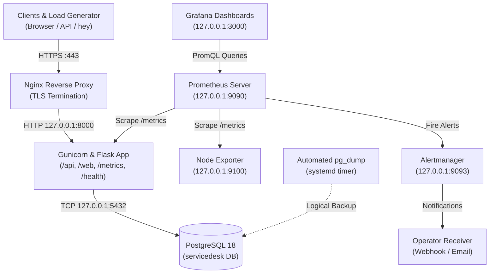

# Service Desk Platform - Part 2: Operations & Observability Report

## 1. Operational Context & Problem Statement
Following the production deployment of the **Service Desk Platform** in Part 1 (`Nginx + Gunicorn/Flask + PostgreSQL` on `servicedesk-vm`), ensuring functional availability alone is insufficient for reliable service operation. As the service operator, it is necessary to continuously observe system health, detect performance degradation before users are impacted, receive automated alerts during failures, evaluate capacity limits under load, and guarantee data continuity through automated backups and tested recovery procedures.

This report documents the implementation of the observability, alerting, performance testing, backup, and incident response architecture designed to answer critical operational questions:
- Is the service currently available and healthy across all layers (API, Web UI, Database)?
- Is response latency increasing or are HTTP error rates spiking?
- How much CPU, RAM, and disk capacity remain available on the virtual machine?
- When did the last failure occur, and which component triggered it?
- Can we recover the data if the database is lost, and how long does it take to restore the service within defined RPO and RTO targets?

---

## 2. Operational Architecture
To maintain low resource overhead on the virtual machine (`2 vCPU`, `1.6 GiB RAM`, `18 GB Storage`), the observability and backup components are deployed natively alongside the application stack as isolated `systemd` services bound strictly to the local loopback interface (`127.0.0.1`), with administrative dashboards accessed securely via Nginx HTTPS reverse proxy or local SSH port forwarding.

### 2.1 Operational Component & Telemetry Flow Diagram

---

## 3. Phase 1: Definition & Justification of Service Indicators

Before deploying monitoring agents, key Service Level Indicators (SLIs) were defined across three layers—infrastructure, application service, and database—to ensure complete end-to-end observability without unnecessary metric overhead.

### 3.1 Infrastructure Indicators (Host Layer)
Collected from the Linux virtual machine via **Node Exporter** (`/proc` and `/sys` kernel metrics):

| Indicator | Metric / Measurement | Operational Justification |
| :--- | :--- | :--- |
| **CPU Utilization** | Percentage of non-idle CPU time (`user`, `system`, `iowait`) | Identifies compute saturation caused by concurrent Gunicorn workers, TLS handshakes, or database queries on the 2-vCPU host. |
| **Memory Utilization** | Available vs. total physical RAM (`1.6 GiB`) and swap usage | Prevents Out-Of-Memory (OOM) terminations of PostgreSQL or Python processes under memory pressure. |
| **Disk Space Usage** | Used filesystem percentage on the root partition `/` (`18 GB`) | Ensures PostgreSQL data files, logs, and automated backups do not exhaust disk space and halt write operations. |
| **System Load Average** | 1-minute, 5-minute, and 15-minute runnable process queue (`node_load1/5/15`) | Complements CPU percentage by revealing process contention and disk I/O wait bottlenecks relative to the 2 CPU cores. |
| **Network Traffic** | Inbound/outbound bytes and packets per second (`RX/TX`) | Tracks client request volume, detects abnormal traffic spikes, and verifies network interface health. |

### 3.2 Application Service Indicators (API & Web Layer)
Exposed directly by the **Flask / Gunicorn** backend through a dedicated `/metrics` endpoint:

| Indicator | Metric / Measurement | Operational Justification |
| :--- | :--- | :--- |
| **Request Throughput** | Total HTTP requests partitioned by method, endpoint, and status code | Measures real-time traffic demand and distinguishes read operations (`GET`) from write operations (`POST`/`PUT`/`DELETE`). |
| **HTTP Error Rate** | Rate of `4xx` (client) and `5xx` (server) responses | Detects broken client requests (`4xx`) and internal application or database failures (`5xx`) immediately. |
| **Request Latency** | HTTP request duration histogram (`p50`, `p95`, `p99` response times) | Tracks median (`p50`) and worst-case (`p95`/`p99`) response times so service slowdowns are detected before reaching Nginx proxy timeout.|
| **Service Availability** | Prometheus `up` scrape target state (`1` = up, `0` = down) | Provides binary confirmation that the Gunicorn WSGI process is alive and responding to monitoring probes. |

### 3.3 Database Indicators (Persistence Layer)
Verified via active application probing (`/health` endpoint) and `systemd` service status:

| Indicator | Metric / Measurement | Operational Justification |
| :--- | :--- | :--- |
| **Database Availability** | Active `SELECT 1` connectivity check executed by `/health` | Confirms not only that the `postgresql` daemon is active, but that `servicedesk_user` can authenticate and execute SQL queries. |
| **DB Query Latency** | Round-trip execution time (in ms) of the `SELECT 1` probe | Complementary metric that exposes database connection latency increases. |

---

## 4. Phase 2: System Monitoring Deployment (Node Exporter & Prometheus)

To collect host-level infrastructure metrics without exposing administrative ports to external networks, **Node Exporter (`v1.8.2`)** and **Prometheus (`v2.55.1`)** were deployed as native `systemd` services bound strictly to the loopback interface (`127.0.0.1`).

### 4.1 Service Isolation & Resource Hardening
- **Least-Privilege Execution:** Dedicated unprivileged system accounts (`node_exporter` and `prometheus`) with `/usr/sbin/nologin` shells own the binaries, configuration directories (`/etc/prometheus`), and time-series storage (`/var/lib/prometheus`).
- **Network Isolation:** Both services listen exclusively on `127.0.0.1` (`:9100` and `:9090`), keeping them unreachable from external interfaces while remaining accessible to local scrape targets and SSH tunnels.
- **Storage Retention Caps:** Prometheus is configured with `--storage.tsdb.retention.time=15d` and `--storage.tsdb.retention.size=1GB` to prevent time-series data from exhausting the VM's `18 GB` root filesystem.
- **Reproducible Configuration:** Service unit files (`config/systemd/node_exporter.service`, `config/systemd/prometheus.service`) and scrape definitions (`config/prometheus/prometheus.yml`) are version-controlled in the repository.

### 4.2 Scrape Configuration (`config/prometheus/prometheus.yml`)
Prometheus polls metrics every `15s` from two initial targets:
- `prometheus` (`127.0.0.1:9090`): Self-monitoring of the Prometheus server health and TSDB ingestion.
- `node_exporter` (`127.0.0.1:9100`): Host CPU, memory, disk, load average, and network telemetry.

### 4.3 Verification Evidence
Service activation and target discovery were validated via `systemctl` and the Prometheus Targets HTTP API (`/api/v1/targets`):
- `systemctl is-active node_exporter prometheus` returned `active` for both units.
- `curl -s http://127.0.0.1:9100/metrics` confirmed live kernel metric exposition.
- Querying `http://127.0.0.1:9090/api/v1/targets` confirmed `"health": "up"` for both `node_exporter` and `prometheus` scrape jobs.