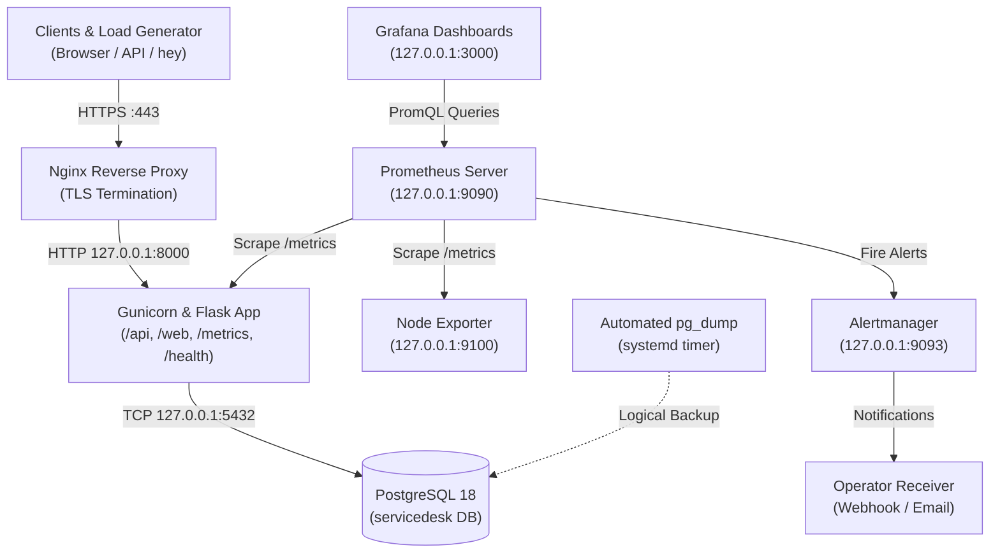

# Service Desk Platform - Part 2: Operations & Observability Report

## 1. Operational Context & Problem Statement
Following the production deployment of the **Service Desk Platform** in Part 1 (`Nginx + Gunicorn/Flask + PostgreSQL` on `servicedesk-vm`), ensuring functional availability alone is insufficient for reliable service operation. As the service operator, it is necessary to continuously observe system health, detect performance degradation before users are impacted, receive automated alerts during failures, evaluate capacity limits under load, and guarantee data continuity through automated backups and tested recovery procedures.

This report documents the implementation of the observability, alerting, performance testing, backup, and incident response architecture designed to answer critical operational questions:
- Is the service currently available and healthy across all layers (API, Web UI, Database)?
- Is response latency increasing or are HTTP error rates spiking?
- How much CPU, RAM, and disk capacity remain available on the virtual machine?
- When did the last failure occur, and which component triggered it?
- Can we recover the data if the database is lost, and how long does it take to restore the service within defined RPO and RTO targets?

---

## 2. Operational Architecture
To maintain low resource overhead on the virtual machine (`2 vCPU`, `1.6 GiB RAM`, `18 GB Storage`), the observability and backup components are deployed natively alongside the application stack as isolated `systemd` services bound strictly to the local loopback interface (`127.0.0.1`), with administrative dashboards accessed securely via Nginx HTTPS reverse proxy or local SSH port forwarding.

### 2.1 Operational Component & Telemetry Flow Diagram
