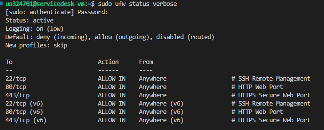

# Service Desk Platform - Technical Report

## 1. System Architecture & Infrastructure Overview
- **Operating System:** Linux (Ubuntu)
- **Hostname:** `servicedesk-vm`
- **Assigned IP Address:** `156.35.165.47/24`
- **Hardware Resources:**
  - **CPU Cores:** `2`
  - **RAM:** `1.6 GiB`
  - **Storage:** `18 GB`

---

## 2. Phase 1: Machine Preparation & Hardening

### 2.1 System Updates, User Management & SSH
- System package index was updated and all packages were upgraded to their latest versions via `apt update && apt upgrade`.
- Hostname was configured to `servicedesk-vm` using `hostnamectl set-hostname`.
- Created a non-privileged system user `servicedesk` (`adduser --system --group --disabled-login servicedesk`) to run application services under the principle of least privilege.
- Remote SSH access on TCP port 22 was verified and restricted to default infrastructure access controls.
- Outbound network connectivity was confirmed via ICMP ping checks to external DNS resolvers.

### 2.2 Network Hardening & Port Justification
The network firewall (`ufw`) is configured with a strict `default deny incoming` policy. Only essential public web and management services are exposed externally, while backend database and application services remain strictly bound to `localhost`:

| Port | Protocol | Service | Exposure | Justification |
| :--- | :--- | :--- | :--- | :--- |
| **22** | TCP | SSH | Public | Remote VM administration and maintenance. |
| **80** | TCP | HTTP | Public | Public entry point for static assets and HTTP to HTTPS redirection. |
| **443** | TCP | HTTPS | Public | Secure entry point for Nginx reverse proxy serving Web UI and API endpoints. |
| **5432** | TCP | PostgreSQL | Internal (`localhost`) | Relational database engine, isolated from public access. |
| **5000** | TCP | REST API (Gunicorn / Flask) | Internal (`localhost`) | Application backend engine, accessible exclusively via Nginx proxy. |

#### Verification Evidences:

---

## 3. Phase 2: Database Service & Schema Design

### 3.1 Database Service & Dedicated Credentials
- Installed and configured **PostgreSQL** relational database engine.
- Created a dedicated database named `servicedesk`.
- Created an application-specific non-root user `servicedesk_user` with restricted access privileges on the `servicedesk` database. The application does not use administrative database credentials.

### 3.2 Schema Architecture & Entity Definitions
The database schema consists of three relational entities designed to handle user roles, ticket reporting, and comment threads:

- **`users` Table:** Stores user profile attributes (`id`, `name`, `email`, `created_at`).
- **`incidents` Table:** Stores incident tickets (`id`, `title`, `description`, `priority`, `status`, `created_at`, `updated_at`).
- **`comments` Table:** Stores discussion comments linked to specific incidents and users (`id`, `incident_id`, `user_id`, `comment`, `created_at`).

#### SQL Schema Definition File:
The table structures were initialized using `config/database/schema.sql`.

#### Verification Evidences:
- PostgreSQL database creation and schema assignment verified via `psql \dt` output.

---

## 4. Phase 3: REST API Implementation

### 4.1 Backend Application Architecture
- Developed a Python Flask application following a modular Blueprint architecture (`src/api/`).
- Integrated **Flask-SQLAlchemy** ORM for PostgreSQL database interactions.
- Configured connection parameters to use the unprivileged `servicedesk_user` database account.

### 4.2 Endpoint Specifications & Verification
Implemented full CRUD operational endpoints:
- **`GET /api/users` & `POST /api/users`**: User profile query and creation.
- **`GET /api/incidents` & `POST /api/incidents`**: Incident management endpoints.
- **`GET /api/incidents/<id>` & `PUT /api/incidents/<id>` & `DELETE /api/incidents/<id>`**: Incident retrieval, status/priority update, and removal.
- **`GET /api/incidents/<id>/comments` & `POST /api/incidents/<id>/comments`**: Incident comment thread handlers.

### 4.3 Verification Evidence:
- Endpoints tested using `curl` HTTP requests against local Flask application service.
- Database operations confirmed with SQL table queries.

---

## 5. Phase 4: API Documentation (OpenAPI / Swagger)

### 5.1 Swagger UI Integration
- Integrated `flasgger` framework into the Flask application to provide interactive OpenAPI specification UI.
- Configured documentation routing under the `/apidocs` endpoint.

### 5.2 OpenAPI Docstrings Implementation
- Annotated all REST endpoints (`/api/users`, `/api/incidents`, `/api/incidents/<id>/comments`) with YAML-formatted OpenAPI specifications in `src/api/routes.py`.
- Defined explicit request body schemas, input parameters, and HTTP response codes (`200`, `201`, `400`, `404`, `409`).

### 5.3 Verification Evidence
- Verified endpoint browsing and schema validation through the interactive UI at `http://127.0.0.1:5000/apidocs`.